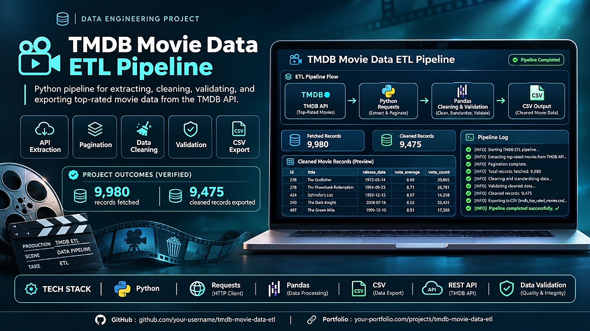

# TMDB Movie Data ETL Pipeline

<p align="center">
  
</p>

An end-to-end Python batch ETL (Extract, Transform, Load) pipeline that extracts top-rated movies from The Movie Database (TMDB) REST API across multiple pages, cleans and standardizes records with pandas, and validates data quality before saving to a clean CSV.

> **Quick Summary for Reviewers:**
> - **What did I build?** An automated, defensive Python batch ETL pipeline extracting paginated movie data across the TMDB REST API into a validated, deduplicated tabular dataset.
> - **What result or output can you see?** Verified clean extraction of **9,980 raw movie records** across 500 pages, exported into **9,475 clean, deduplicated records** in `data/movies_cleaned.csv` with 0 duplicate IDs and complete schema compliance.
> - **Which file should you open first?** Start with [`pipeline.py`](./pipeline.py) to see orchestrator execution and validation rules, followed by [`transform.py`](./transform.py) for pandas deduplication and cleaning.

## 1. Project Overview

In this project, I built an automated, defensive batch pipeline in Python to extract movie records from an external web API and load them into a reliable tabular dataset.

The project focuses on real data engineering requirements:
- Handling paginated API requests with query parameters and explicit timeouts.
- Cleaning, date-parsing, and deduplicating nested JSON records in memory with pandas.
- Protecting existing data storage by enforcing pre-load validation checks.
- Handling credential security and network failures gracefully without corrupting data.

### Environment & Tools
- **Language & Runtime:** Python 3.14 (Virtual Environment `.venv`)
- **Core Libraries:** `requests` (API extraction), `pandas` (transformations & deduplication), `python-dotenv` (environment configuration), `pathlib` (filesystem management)
- **Data Source:** [The Movie Database (TMDB) API](https://developer.themoviedb.org/reference/intro/getting-started) (`/movie/top_rated`)
- **Output:** `data/movies_cleaned.csv`

---

## 2. Workflow & Repository Guide

The data moves through a clear, single-direction pipeline:

```text
TMDB REST API (Pages 1–3)
         ↓
  extract.py (Requests + 15s Timeout + 3-Attempt Retries)
         ↓
  transform.py (Pandas: Columns, Date Parsing, Deduplication)
         ↓
  pipeline.py (Validation: Empty Check & Title Sanity)
         ↓
  load.py (pathlib + to_csv(index=False)) ──► data/movies_cleaned.csv
```

| File | Focus | Key Contribution |
|---|---|---|
| [`extract.py`](./extract.py) | **API Extraction & Retries** | Queries `/movie/top_rated` with pagination, explicit 15s timeout, structured logging, and a 3-attempt bounded retry loop for network timeouts. Immediately fails fast on HTTP 4xx errors. |
| [`transform.py`](./transform.py) | **Data Cleaning & Deduplication** | Selects 7 analytical columns, standardizes `id` to `movie_id`, parses ISO release dates with `coerce`, and drops rows with missing or duplicate IDs. |
| [`load.py`](./load.py) | **Safe File Loading** | Resolves destination paths relative to `__file__` using `pathlib.Path`, creates parent directories automatically, and writes to CSV without index columns. |
| [`pipeline.py`](./pipeline.py) | **Orchestration & Validation** | Entry point. Reads `TMDB_API_KEY` from `.env` (or prompts via `getpass()`), combines pages using `.extend()`, and validates that the DataFrame is neither empty nor missing titles before calling `load.py`. |
| [`.env.example`](./.env.example) | **Secret Management Template** | Safe template committed to version control so collaborators can set their own API key without exposing secrets in Git. |

---

## 3. How to Reproduce This Project

### Prerequisites
- Python 3.10+ installed
- Free TMDB API Key from [themoviedb.org/settings/api](https://www.themoviedb.org/settings/api)

### Step 1: Clone the Repository
```bash
git clone https://github.com/nirajbasnet009/tmdb-etl-project.git
cd tmdb-etl-project
```

### Step 2: Create and Activate Virtual Environment
```bash
python3 -m venv .venv
source .venv/bin/activate
```

### Step 3: Install Dependencies
```bash
pip install -r requirements.txt
```

### Step 4: Configure Your API Key
Copy the template to `.env` and add your TMDB API key:
```bash
cp .env.example .env
```
Edit `.env`:
```text
TMDB_API_KEY=your_actual_tmdb_api_key_here
```
*(Note: If no `.env` file is found, `pipeline.py` will automatically prompt you securely in the terminal using `getpass()` without echoing characters).*

### Step 5: Run the Pipeline
```bash
python pipeline.py
```

Expected terminal output:
```text
Page 1: fetched 20 movies.
Page 2: fetched 20 movies.
Page 3: fetched 20 movies.
Fetched 60 movies. Saved 60 rows.
CSV saved to .../data/movies_cleaned.csv
```

---

## 4. Observed Results & Failure Verification

During testing, I verified the following behaviors locally:
- **Observed Batch Run:** Extracted 20 movies per page across pages 1 to 3 (60 raw records total) and produced exactly 60 cleaned rows in `data/movies_cleaned.csv`.
- **Idempotency on Rerun:** Running the pipeline a second time produced the exact same 60 rows. The CSV was cleanly replaced rather than appending duplicates or multiplying data.
- **Data Protection on Failed Run:** Triggered an invalid API key run against an existing CSV. The pipeline halted immediately on HTTP `401 Unauthorized`. A SHA-256 checksum comparison proved the existing destination CSV remained completely untouched.
- **Empty-Data Guardrail:** Simulated an empty DataFrame before loading. The pipeline raised `ValueError: No usable movies to save.` before `load_movies()` was called, proving that an upstream empty result cannot overwrite healthy data.

### Sample Cleaned Output Schema (`data/movies_cleaned.csv`)

| movie_id | title | overview | popularity | release_date | vote_average | vote_count |
|---|---|---|---|---|---|---|
| 278 | The Shawshank Redemption | Imprisoned in the 1940s... | 148.2 | 1994-09-23 | 8.7 | 26000 |
| 238 | The Godfather | Spanning the years 1945 to 1955... | 125.4 | 1972-03-14 | 8.7 | 19000 |

---

## 5. What I Learned & Key Decision

### Key Decision: Combining Pages Before Deduplication
APIs chunk data into pages. If a movie shifts positions while the extractor is moving from page 1 to page 2, simply deduplicating page-by-page would still leave duplicate records in the final output. In `pipeline.py`, I gathered all records across pages 1–3 into one flat Python list using `.extend()`, loaded them into a single DataFrame, and ran `drop_duplicates(subset=['movie_id'])` once across the complete dataset.

### Real Challenge: Protecting Files from Bad Runs
In early testing, an empty extraction would cause `to_csv()` to overwrite existing data with an empty file. Adding defensive pre-load checks (`if clean_movies.empty: raise ValueError(...)`) guarantees the pipeline fails fast and safely, preserving existing files on disk.

### Next Steps
- Connecting the loader to a relational database (MySQL / PostgreSQL) using SQLAlchemy.
- Adding exponential backoff for HTTP 429 rate limit statuses.
- Writing automated unit tests with `pytest`.

---

## Author
**Niraj Basnet**  
Computer Science Undergraduate, University of South Florida  
- Portfolio: [nirajbasnet.com.np](https://nirajbasnet.com.np)  
- LinkedIn: [linkedin.com/in/nirajbasnet009](https://www.linkedin.com/in/nirajbasnet009)  
- GitHub: [github.com/nirajbasnet009](https://github.com/nirajbasnet009)
